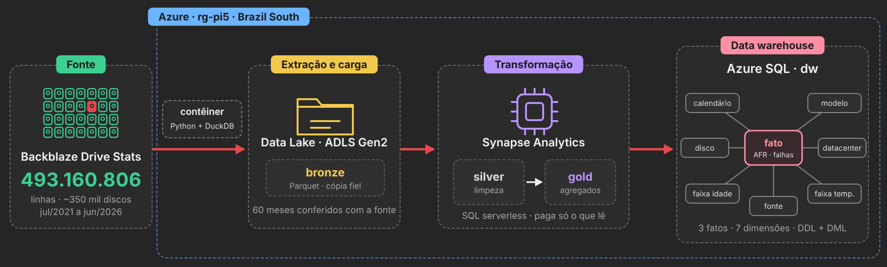
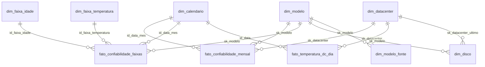

# Apoio decisório na gestão de datacenters

Projeto Integrador do 5º semestre (Senac). Pipeline ELT e data warehouse sobre o
[Backblaze Drive Stats](https://www.backblaze.com/cloud-storage/resources/hard-drive-test-data):
registros diários de SMART e falhas de cerca de 350 mil discos, usados para analisar
confiabilidade por modelo e fabricante, fatores de risco (temperatura, idade, localização)
e sinais de falha iminente.

**Vídeo demonstrativo (1 min):** [docs/video_PI5_grupo2.mp4](docs/video_PI5_grupo2.mp4)

## Perguntas de negócio

As perguntas resumem as atividades de apoio decisório definidas na 1ª etapa. O modelo dimensional foi
derivado delas, e as operações OLAP respondem a elas.

| # | Pergunta | Decisão apoiada | Onde está no DW | Consulta OLAP |
|---|---|---|---|---|
| 1 | **Confiabilidade:** qual modelo ou fabricante falha menos? | especificação dos próximos lotes de compra | `fato_confiabilidade_mensal` × `dim_modelo` (AFR) | [01](olap/consultas/01_rollup_afr_fabricante_modelo.sql), [05](olap/consultas/05_pivot_afr_fabricante_ano.sql) |
| 2 | **Fatores de risco:** temperatura, idade e localização influenciam as falhas? | ajuste de refrigeração e prioridades de infraestrutura | `fato_confiabilidade_faixas` (faixas de idade e de temperatura), `fato_confiabilidade_mensal` × `dim_datacenter` | [03](olap/consultas/03_slice_afr_temperatura_2025.sql) |
| 3 | **Manutenção preditiva:** quais atributos SMART sinalizam falha iminente? | fila de substituição preventiva | `dim_disco` (máximos dos SMART 5, 187, 188, 197 e 198 e situação do disco) | [07](olap/consultas/07_smart_preditores_falha.sql) |
| 4 | **Setorização física:** há datacenter com mais falhas ou mais quente? | investigação de causas locais | `fato_temperatura_dc_dia` (p50, p95 e máximo por dia), `fato_confiabilidade_mensal` × `dim_datacenter` | [06](olap/consultas/06_temperatura_datacenter.sql) |
| 5 | **Vida útil e substituição:** como o AFR evolui com a idade do disco? | planejamento de reposição | `fato_confiabilidade_faixas` × `dim_faixa_idade` | [02](olap/consultas/02_drilldown_afr_ano_trimestre_mes.sql), [04](olap/consultas/04_dice_afr_fabricante_idade.sql) |

## Arquitetura

```
Backblaze Drive Stats (Apache Iceberg, S3 público da Backblaze)
   │  E + L: Python + DuckDB num contêiner do Azure Container Instances
   │         snapshot mais recente, 4 meses em paralelo, conciliação com o manifesto
   ▼
ADLS Gen2  lake/bronze/drivestats/      Parquet com os nomes originais da fonte
   │  T: Synapse Analytics, pool SQL serverless
   ▼
ADLS Gen2  lake/silver/  →  lake/gold/  dados limpos → agregados do modelo dimensional
   │  carga
   ▼
Azure SQL Database  dw                   DDL, DML e operações OLAP
```



Todos os recursos ficam no grupo `rg-pi5`, região Brazil South, numa assinatura Azure for Students.

## Tecnologias

| Tecnologia | Uso | Por quê |
|---|---|---|
| Python 3.12 + [uv](https://docs.astral.sh/uv/) | código da extração e carga | dependências travadas em `uv.lock`, ambiente reproduzível |
| DuckDB (extensões `iceberg` e `httpfs`) | leitura da tabela Iceberg e gravação em Parquet | lê Iceberg direto do S3 da Backblaze, que o Synapse não lê; roda dentro do processo, sem servidor |
| Azure Container Instances | execução da extração na nuvem | contêiner sob demanda, cobrado só enquanto roda; não depende da máquina de ninguém |
| ADLS Gen2 | data lake (bronze, silver, gold) | armazenamento hierárquico barato, lido nativamente pelo Synapse |
| Synapse Analytics (serverless) | transformação em SQL sobre o lake | cobrado por volume lido, sem cluster ligado |
| Azure SQL Database (oferta gratuita) | data warehouse | T-SQL completo para DDL, DML e OLAP, sem custo dentro da cota mensal |
| Microsoft Entra ID + identidades gerenciadas | autenticação | nenhuma senha ou chave no código; acesso por papel (RBAC) |
| az CLI + Bash | provisionamento | scripts idempotentes em `infra/` |
| GitHub Actions, ruff, pytest | qualidade | lint, formatação e testes a cada push e pull request |

## Fonte de dados

Tabela Apache Iceberg pública mantida pela Backblaze, no bucket `drivestats-iceberg`, lida com as
credenciais **somente leitura** que a própria Backblaze divulga (`config/fonte_dados.json`).
Documentação da fonte: <https://www.backblaze.com/cloud-storage/resources/hard-drive-test-data>.

- **Janela:** 2021-07 a 2026-06, 20 trimestres fechados.
- **Volume carregado:** **493.160.806 linhas** em 60 meses, conferidas mês a mês com o manifesto do
  snapshot `00262` da tabela.
- **Limitações:** os campos de localização (`datacenter`, `cluster_id`, `vault_id`, `pod_id`) só existem
  a partir de 2023. Discos que já operavam em 2021-07 têm vida anterior não observada (censura à
  esquerda); o SMART 9 (horas ligado) permite estimar a idade.

## Extração e carga (E e L)

O pacote `drivestats_el` (em `src/drivestats_el/`) copia a tabela Iceberg para a camada bronze, mês a mês.

1. **Snapshot e contagem.** Localiza o metadata.json mais recente da tabela e soma as linhas por mês
   no manifesto, ignorando arquivos marcados como removidos.
2. **Extração.** Cada mês é lido em fatias de 7 dias (um Parquet por fatia, compressão zstd), para
   limitar a memória. Entram as colunas de identificação e os 44 atributos SMART com pelo menos 1% de
   preenchimento na janela (`src/drivestats_el/catalogo_smart.py`), com os nomes originais da fonte.
3. **Carga.** As fatias do mês substituem o conteúdo da pasta `ano_mes=AAAA-MM` no lake.
4. **Conciliação.** Linhas gravadas devem ser iguais às do manifesto. O resultado fica em
   `_controle/AAAA-MM.json`, no próprio lake: status, snapshot, linhas, bytes e duração.
5. **Retomada.** Um mês só é refeito se não estiver no destino, se falhou na conciliação ou se a
   contagem na fonte mudou. Interromper e rodar de novo continua de onde parou.

Vários meses rodam ao mesmo tempo (`--paralelo`), cada um num processo com a própria conexão DuckDB.
Com 4 em paralelo, num contêiner de 4 vCPU e 16 GB, a janela completa levou 25 minutos.

Estrutura da bronze:

```
lake/bronze/drivestats/
├── ano_mes=2021-07/parte_01.parquet ... parte_29.parquet
├── ...
├── ano_mes=2026-06/...
└── _controle/2021-07.json ... 2026-06.json
```

## Transformação (T)

A camada de transformação processa os dados brutos da camada bronze, aplicando limpeza, deduplicação, padronização e saneamento métrico no Azure Synapse Analytics (pool SQL Serverless).

### Camada Silver (`silver.disco_dia` e `silver.disco_dia_enriquecida`)

Os scripts da camada Silver ficam em [`sql/transformacao/silver/`](sql/transformacao/silver/) e operam como views lógicas sobre o Data Lake, garantindo zero redundância de armazenamento para os ~493 milhões de registros:

1. **`01_preparacao_ambiente.sql`**: Configura credenciais com *Managed Identity*, External Data Source (`lake`), External File Format (`PARQUET`) e esquemas lógicos (`bronze`, `silver`, `gold`).
2. **`02_view_bronze_drivestats.sql`**: Mapeia os arquivos Parquet da bronze expondo a partição virtual `ano_mes` via `filepath(1)`, viabilizando a poda de partições (*partition pruning*) e reduzindo custos de leitura no Serverless.
3. **`03_view_silver_disco_dia.sql`**: View consolidada da Silver com granularidade de **1 linha por disco por dia**:
   - **Deduplicação:** Mantém apenas um registro por disco e dia (`ROW_NUMBER() OVER (PARTITION BY ano_mes, _serie, date ORDER BY failure DESC) = 1`), priorizando registros de falha.
   - **Padronização de modelo e fabricante:** Prefixagem de modelos `WUH%` com `WDC ` (unifica os modelos Western Digital gravados sem o prefixo) e regras ordenadas de mapeamento de marcas (`Seagate`, `Western Digital`, `Toshiba`, `Micron`, `Samsung`, `Dell BOSS`, etc.).
   - **Mídia e função:** Classificação em `SSD` vs `HDD` por padrões de modelo, e atribuição de `funcao_disco` em `boot` (se SSD ou capacidade < 2 TB) ou `dados`.
   - **Saneamento métrico:** Capacidades $\le 0$ tratadas como nulas e conversão para `capacidade_tb`; correção de temperatura do SMART 194 (extração do byte inferior `& 255` em leituras compostas $> 255$ da Seagate e filtro 1–100 °C); filtro de horas ligado do SMART 9 (0–200.000 h) e cálculo da `idade_anos`.
   - **Tradução e catálogo SMART:** Renomeação padronizada em português dos 44 atributos SMART com cobertura $\ge 1\%$ (`smart_XXX_<nome>_bruto` e `_normalizado`).
4. **`04_qualidade_silver.sql`**: Consulta de qualidade parametrizada por `ano_mes`: contagens, discos distintos, falhas e indicadores que separam valores ausentes na fonte de valores inválidos anulados pela silver.
5. **`05_view_silver_disco_dia_enriquecida.sql`**: View com enriquecimento analítico:
   - **Manutenção Preditiva:** Flags para os 5 atributos SMART preditores da Backblaze (`smart_5`, `smart_187`, `smart_188`, `smart_197`, `smart_198`) e flag composta `flg_risco_falha_iminente`.
   - **Segmentações operacionais:** Faixas de temperatura de 5 em 5 °C e faixas de idade em anos, com rótulos neutros e colunas de ordem (`ordem_faixa_temperatura`, `ordem_faixa_idade`) para ordenar nas consultas OLAP; flag de temperatura $\ge 40$ °C e flag para registros sem datacenter (localização só existe a partir de 2023).
6. **`06_auditoria_regras_silver.sql`**: Consultas de auditoria, para rodar à mão, com 4 testes de integridade (volumetria e descarte de duplicatas, monitoramento de marcas desconhecidas, saneamento conferido contra a bronze e comparação entre alertas preditivos e falhas reais).

### Camada Gold (`sql/transformacao/gold/`)

A gold é calculada no Synapse serverless e gravada no lake (`lake/gold/`) com CETAS (`CREATE EXTERNAL TABLE AS SELECT`). As agregações pesadas sobre os ~493 milhões de dias-disco ficam no serverless; o Azure SQL recebe só o resultado, que é pequeno.

- **Intermediária `disco_mes`:** uma linha por disco × mês × datacenter do dia (~20 milhões de linhas). Todas as medidas são somas, contagens ou máximos, então reagregam sem erro para o disco, o modelo ou a fato mensal, sem reler a silver.
- **Materialização por ano:** as CETAS que leem a silver rodam um ano por vez, com filtro literal em `ano_mes`. O filtro chega até a bronze (`filepath(1)`), que lê só as pastas do ano, e cada execução fica longe do limite de ~30 min do serverless.
- **Último valor sem janela:** o último datacenter e o último modelo de cada disco saem de `MAX('AAAA-MM-DD' + valor)`, sem `ROW_NUMBER` sobre centenas de milhões de linhas.
- **Datacenter efetivo:** `COALESCE(datacenter do dia, último datacenter conhecido do disco)`; sem nenhum, `desconhecido`. As fatos guardam quantos dias-disco foram imputados (viés de sobrevivência em 2021-2022).
- **Percentis de temperatura (p50, p95):** calculados por histograma por grau (a temperatura é inteira), com soma acumulada, método do posto mais próximo.
- **Catálogo dos fabricantes:** os CSVs de `config/` são copiados para `lake/referencia/` e lidos com `OPENROWSET` (CSV, parser 2.0). Modelos fora do catálogo entram com as especificações nulas.
- **Conferência:** `90_conferencia_gold.sql` compara dias-disco e falhas entre a bronze e todas as tabelas da gold.

## Data warehouse: DDL e DML

O data warehouse fica no Azure SQL Database (banco `dw`), em esquema estrela:



| Tabela | Grão | Medidas principais |
|---|---|---|
| `fato_confiabilidade_mensal` | mês × modelo × datacenter | `dias_disco`, `falhas`, `dias_disco_imputados`, `discos_distintos`, `tb_dias`, soma/contagem de temperatura, `afr_pct` (calculada) |
| `fato_confiabilidade_faixas` | mês × modelo × faixa de idade × faixa de temperatura | `dias_disco`, `falhas`, `afr_pct` (calculada) |
| `fato_temperatura_dc_dia` | dia × datacenter × tipo de mídia | discos, capacidade, soma/contagem de temperatura, p50, p95, máximo, falhas |
| `dim_modelo` | modelo | fabricante, mídia, função, capacidade, especificações do catálogo (MTBF, AFR declarado, potência, garantia) |
| `dim_disco` | disco | primeira e última data, situação (ativo, falhou, retirado), último datacenter, horas, temperatura, máximos dos SMART 5, 187, 188, 197 e 198 |
| `dim_calendario`, `dim_datacenter`, `dim_modelo_fonte`, `dim_faixa_*` | — | atributos para filtro e hierarquia (ano → trimestre → mês; fabricante → modelo) |

- **DDL** ([`sql/ddl/`](sql/ddl/)): tabelas com tipos, PK, FK, `UNIQUE`, `CHECK` e colunas calculadas (`afr_pct`, `temperatura_media`). Dimensões com chave substituta (`sk_*`), fatos com PK no grão. Scripts idempotentes (`IF OBJECT_ID(...) IS NULL`).
- **Carga:** uma atividade Copy do Synapse Pipelines leva o Parquet da gold para tabelas de staging (`stg.*`), com os mesmos nomes de coluna.
- **DML** ([`sql/dml/`](sql/dml/)): `MERGE` da staging para dimensões e fatos, trocando nomes e códigos pelas chaves substitutas; `dim_calendario` é gerada no banco e `dim_datacenter` vem de `config/datacenters.json`. Cada carga valida a staging (vazia, chave repetida, código sem dimensão) no mesmo lote do `MERGE`; se falhar, nada é gravado.
- **AFR:** `100 × falhas / (dias_disco / 365)`. Ao reagregar, as consultas somam `falhas` e `dias_disco` e recalculam; nunca tiram média de AFR.

Ordem de execução completa (gold, DDL, cópia e DML): [`sql/README.md`](sql/README.md).

## Conferência entre as camadas

Executada em 20/11/2026 com os scripts [`90_conferencia_gold.sql`](sql/transformacao/gold/90_conferencia_gold.sql)
(Synapse) e [`11_conferencia_dw.sql`](sql/dml/11_conferencia_dw.sql) (Azure SQL). Resultados completos,
inclusive mês a mês: [`docs/conferencia_camadas.md`](docs/conferencia_camadas.md).

| Camada | Tabela | Dias-disco | Falhas |
|---|---|---:|---:|
| bronze | `bronze.drivestats` | 493.160.806 | 20.310 |
| gold | `gold.disco_mes` | 493.160.806 | 20.310 |
| gold | `gold.fato_confiabilidade_mensal` | 493.160.806 | 20.310 |
| gold | `gold.fato_confiabilidade_faixas` | 493.160.806 | 20.310 |
| gold | `gold.fato_temperatura_dc_dia` | 493.160.806 | 20.310 |
| DW | `dbo.fato_confiabilidade_mensal` | 493.160.806 | 20.310 |
| DW | `dbo.fato_confiabilidade_faixas` | 493.160.806 | 20.310 |
| DW | `dbo.fato_temperatura_dc_dia` | 493.160.806 | 20.310 |

- **Nenhuma linha perdida ou duplicada** da bronze até o DW. Como a gold é calculada a partir da silver,
  a igualdade também mostra que a deduplicação da silver não encontrou duplicatas.
- **Mês a mês:** nos 60 meses, a diferença entre a bronze e a fato mensal é zero.
- **`dim_disco`:** 20.271 discos com falha para 20.310 registros de falha. A diferença (39) corresponde a
  discos com mais de uma falha registrada, como prevê o script de conferência.
- **Staging × DW:** dimensões e `fato_confiabilidade_faixas` têm a mesma contagem de linhas. A
  `fato_confiabilidade_mensal` (10.763 → 10.366 linhas) e a `fato_temperatura_dc_dia` (20.180 → 18.722)
  ficam com menos linhas no DW porque a carga junta o datacenter vazio da fonte e o `desconhecido` na
  mesma chave (`GROUP BY` antes do `MERGE`). Os totais de dias-disco e falhas não mudam.

## Operações OLAP

Consultas em [`olap/consultas/`](olap/consultas/) e resultados em [`olap/evidencias/`](olap/evidencias/),
executados no banco `dw`. Regras comuns: só discos de dados (`funcao_disco = 'dados'`, os discos de boot
ficam de fora), AFR sempre recalculado a partir das somas e, nas comparações por modelo, corte de
100 mil dias-disco. A view [`vw_confiabilidade_estrela`](olap/consultas/00_view_confiabilidade_estrela.sql)
junta a fato por faixas às dimensões e serve de base para as consultas 03 e 04; a conferência da view
mostra as mesmas linhas (47.258), falhas (20.310) e dias-disco (493.160.806) da fato.

| Operação | Consulta | Pergunta | O que mostra |
|---|---|---|---|
| **Roll-up** (modelo → fabricante → total) | [01](olap/consultas/01_rollup_afr_fabricante_modelo.sql) | 1 | AFR na janela completa: Western Digital 0,61%, Toshiba 1,17%, HGST 1,82%, Seagate 1,92%; frota de dados 1,48%. Dentro de cada fabricante, os modelos variam bastante (Seagate de 0,36% a 6,74%). |
| **Drill-down** (ano → trimestre → mês) | [02](olap/consultas/02_drilldown_afr_ano_trimestre_mes.sql) | 5 | Seagate: o AFR anual sobe de 1,54% (2021) para 2,44% (2023) e volta a 1,58% em 2025; o pico trimestral é o 2º trimestre de 2023 (3,20%). |
| **Slice** (ano = 2025) | [03](olap/consultas/03_slice_afr_temperatura_2025.sql) | 2 | AFR por faixa de temperatura: entre 25 °C e 44 °C fica entre 1,18% e 1,38%; os extremos sobem (2,68% abaixo de 20 °C e 2,18% a partir de 45 °C). A faixa "não informada" tem só 220 dias-disco e não permite conclusão. |
| **Dice** (fabricante × período × idade) | [04](olap/consultas/04_dice_afr_fabricante_idade.sql) | 5 | AFR de Seagate, Toshiba e Western Digital em 2024–2025, nas faixas a partir de 3 anos de idade. |
| **Pivot** (fabricantes × anos) | [05](olap/consultas/05_pivot_afr_fabricante_ano.sql) | 1 | HGST passa de 0,34% (2021) para 3,79% (2026); Western Digital fica abaixo de 1% em todos os anos; Toshiba é a mais estável (0,89% a 1,25%). |
| Complementar | [06](olap/consultas/06_temperatura_datacenter.sql) | 4 | De 2023 em diante, `sac2` e `ams5` são os dois datacenters mais quentes em todos os anos (médias entre 33,8 °C e 37,6 °C), e o `sac2` tem o maior AFR em 2024 e 2026. |
| Complementar | [07](olap/consultas/07_smart_preditores_falha.sql) | 3 | 79,6% dos discos que falharam tinham algum dos cinco SMART preditores acima de zero, contra 9,3% dos que não falharam. |

## Decisões técnicas e limitações

### Decisões

- **ELT em vez de ETL.** O Synapse serverless não lê tabelas Iceberg. A extração com DuckDB converte o
  snapshot da fonte em Parquet na bronze, e a transformação acontece dentro do lake. Foram avaliadas a
  cópia direta dos arquivos do Iceberg (perderia o esquema unificado entre os anos e traria colunas quase
  vazias) e o Spark (cluster cobrado por hora, desproporcional para ~16 GB).
- **Silver como view, gold materializada.** A silver não duplica os ~493 milhões de linhas; a gold é
  pequena e consultada muitas vezes, por isso é gravada com CETAS.
- **Agregações no serverless, só a gold no Azure SQL.** O serverless cobra por volume lido e o Azure SQL
  usa a oferta gratuita (cota mensal de processamento, pausa automática).
- **Gold materializada um ano por vez,** para cada consulta ficar abaixo do limite de ~30 min do serverless.
- **Região Brazil South:** assinaturas Azure for Students só criam Azure SQL em algumas regiões (teste em
  [`infra/README.md`](infra/README.md)).
- **Sem senhas:** autenticação só por Microsoft Entra ID e acesso por papel (RBAC).
- **AFR sempre recalculado a partir das somas** de falhas e dias-disco, nunca por média de AFR.

### Limitações

- **Localização só a partir de 2023.** Antes disso, o datacenter é imputado pelo último local conhecido do
  disco: 100% dos dias-disco em 2021 e 2022 e 47,2% em 2023. Discos que saíram da frota antes de 2023 ficam
  como `desconhecido` (3,71% em 2021, 2,21% em 2022, 0,35% em 2023), o que gera viés de sobrevivência.
  Análises por datacenter são mais confiáveis a partir de 2024.
- **Datacenter vazio na fonte.** Parte das linhas traz o datacenter como texto vazio; na carga do DW elas
  vão para `desconhecido` (~16,3 milhões de dias-disco, 3,3%). O AFR por modelo e fabricante não é afetado.
- **Censura à esquerda e à direita.** Discos que já operavam em 2021-07 têm vida anterior não observada (a
  idade vem do SMART 9), e a saída de um disco da frota não equivale a falha.
- **Volume mínimo para o AFR.** Taxas de modelos com pouca observação não são comparáveis; as consultas
  OLAP aplicam o corte da Backblaze (mais de 100 mil dias-disco).
- **Catálogo de fabricantes heterogêneo.** Os fabricantes declaram potência por critérios diferentes, e
  modelos fora do catálogo entram com as especificações nulas.
- **Itens previstos na 1ª etapa fora desta entrega**, que cobra DDL, DML e OLAP: dimensão de localização
  física (vault, pod e slot, que seguem disponíveis na silver), score de risco e limiares de alerta
  calibrados, análise de sobrevivência, dados meteorológicos e painéis.

## Equipe

| Integrante | Frente | Pastas |
|---|---|---|
| Salvatore Gasparini Xerri | extração e carga, infraestrutura no Azure, estrutura e revisão do repositório | `src/`, `infra/`, `config/` |
| Gustavo Aquino de Oliveira | transformação bronze → silver | `sql/transformacao/silver/` |
| Fernanda Santos da Silva | gold, modelo dimensional, DDL e DML | `sql/transformacao/gold/`, `sql/ddl/`, `sql/dml/` |
| Vitor Cristiano Dahmer | operações OLAP | `olap/` |
| Julia Stefanni Muniz dos Santos | documentação técnica, conferência entre as camadas e vídeo | `README.md`, `docs/` |

## Como executar

### Ambiente no Azure

No [Cloud Shell](https://shell.azure.com), já autenticado:

```bash
git clone https://github.com/salvatoregx/pi5-apoio-decisorio-aos-negocios
cd pi5-apoio-decisorio-aos-negocios
bash infra/provisionar.sh        # lake, Synapse, Azure SQL e orçamento
bash infra/extrair_no_azure.sh   # extração da janela completa para o lake
```

Detalhes, região e decisões de segurança: [`infra/README.md`](infra/README.md).

### Extração local

```bash
uv sync
uv run drivestats extrair --inicio 2021-07 --fim 2021-09 --destino local   # grava em data/bronze
uv run drivestats status --destino local
```

Com `PI5_ADLS_CONTA` definida e `az login` feito, o destino padrão passa a ser o lake.
`uv run drivestats --help` lista as opções e as variáveis de ambiente.

### Testes

```bash
uv run ruff check && uv run ruff format --check && uv run pytest
```

Os testes não acessam rede nem o Azure: a fonte é simulada com arquivos Parquet gerados no próprio teste.

## Estrutura do repositório

| Pasta | Conteúdo |
|---|---|
| `src/drivestats_el/` | extração e carga (E e L) |
| `tests/` | testes automatizados |
| `config/` | fonte de dados, datacenters e catálogo de fabricantes |
| `infra/` | provisionamento e extração no Azure |
| `sql/` | transformações (Synapse), DDL e DML (Azure SQL) |
| `olap/` | consultas OLAP e evidências |
| `docs/` | diagrama da arquitetura, vídeo demonstrativo e conferência entre as camadas |
| `.github/` | CI, template de pull request e responsáveis por pasta |
